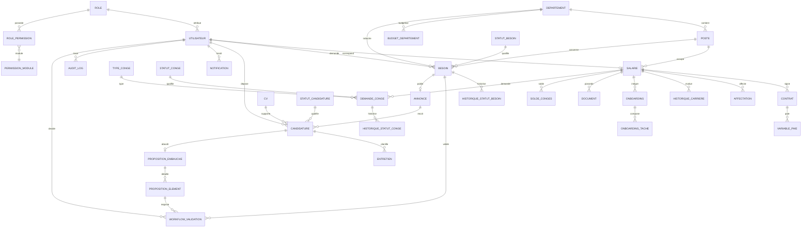

# TalentFlow — SIRH CodeIgniter 4

Socle de gestion RH : recrutement, propositions d’embauche, contrats, temps et congés, paie variable, GED, reporting et audit.

## Prérequis

- PHP 8.2+ avec `mysqli`, `intl`, `mbstring`
- MySQL 5.7+ / MariaDB 10.4+
- CodeIgniter 4 (fourni dans `system/`)

## Installation

```bash
cp .env.example .env   # si nécessaire
# Renseigner database.default.hostname, username, password, database
```

Création de la base et des données de démonstration :

```bash
mysql -uroot < base/init.sql
mysql -uroot < base/data.sql
```

Contrôle de cohérence SQL :

```bash
mysql -uroot < base/test.sql
```

Démarrage :

```bash
php spark serve
```

L’application est alors disponible sur `http://localhost:8080`.

> Le filtre de permissions normalise les URLs préfixées par `index.php/`,
> ce qui évite les redirections parasites quand `app.indexPage = 'index.php'`.

## Comptes de démonstration

Mot de passe commun : **1234**

| Compte | Rôle | Usage |
|---|---|---|
| `dg@mail.com` | DG | Décision finale, budgets, audit |
| `rh@mail.com` | RH | File RH, recrutement, paie, contrats |
| `manager@mail.com` | Manager | Besoins de son département, équipe |
| `employe@mail.com` | Employé | Ses congés, pointages, documents |
| `candidat@mail.com` | Candidat | Candidatures, propositions |

## Bloc 1 — Expression et validation du besoin

### Règles implémentées

1. **Création** par un manager (uniquement son département) ou par le DG (tout département).
   - Poste, département, nombre, type `creation` / `remplacement`, motif, description,
     date souhaitée et salaire estimé.
   - Le salaire par défaut est `poste.salaire_base` ; il reste modifiable dans
     `[salaire_base, salaire_max]`.
2. **Soumission** : statut `En attente RH`.
   - L’étape **finance** est calculée automatiquement dès la soumission par
     `BudgetService`, avec un instantané JSON dans `workflow_validation.details_json`.
3. **Étape RH** : le RH accepte ou refuse.
   - Le commentaire est **obligatoire en cas de refus**.
   - Le besoin passe ensuite en `En attente DG`.
4. **Étape DG** : le DG consulte côte à côte l’avis RH et la finance
   (budget annuel, masse salariale, engagements, coût du besoin, disponible, reste).
   - Sa décision est **finale** : `Validé` ou `Refusé`.
   - Elle l’emporte même si RH et/ou finance ont refusé.
5. **Besoin créé par le DG** : acceptation d’office.
   - RH et finance sont tout de même calculés et conservés pour information.
6. **Portée** :
   - un manager ne voit que ses besoins ;
   - le RH voit tout ;
   - personne ne peut décider sur sa propre demande.
7. **Traçabilité** : `historique_statut_besoin`, `workflow_validation` et `audit_log`.

### Pages

| Page | URL | Rôles |
|---|---|---|
| Mes besoins / tous les besoins | `/besoins` | Manager, RH, DG |
| Nouveau besoin | `/besoins/creer` | Manager, DG |
| File de validation RH | `/besoins/file-rh` | RH, DG |
| File de décision finale DG | `/besoins/file-dg` | DG |
| Détail + frise des décisions | `/besoins/{id}` | Manager (les siens), RH, DG |
| Budgets par département | `/admin/budgets` | RH, DG |

### Fichiers principaux

- `app/Services/BesoinService.php` : création, portée, files RH/DG, détail.
- `app/Services/WorkflowService.php` : moteur générique RH → finance → DG.
- `app/Services/BudgetService.php` : masse salariale, engagements, disponible, instantané.
- `app/Controllers/Besoin.php` : contrôleur mince.
- `app/Views/besoins/` : `index`, `form`, `show`, `file_rh`, `file_dg`.
- `app/Views/admin/budgets.php` : écran budget / masse / engagé / disponible.
- `app/Config/Routes.php` : routes du Bloc 1.
- `base/test.sql` : contrôles SQL de cohérence.
- `tests/block1_workflow_test.php` : tests d’intégration des scénarios métier.

### Tests

```bash
# Contrôles SQL (après init + data)
mysql -uroot < base/test.sql

# Scénarios métier sur une base isolée rh_block1_test
php tests/block1_workflow_test.php
```

Le script PHP crée et supprime `rh_block1_test`. Il couvre notamment :

- refus RH sans commentaire ;
- RH refuse + finance refuse + DG accepte = `Validé` ;
- RH accepte + finance accepte + DG refuse = `Refusé` ;
- tout accepté = `Validé` ;
- création par le DG = validation d’office ;
- portée de lecture du manager ;
- interdiction de décider sur sa propre demande.

## Bloc 2 — Annonces, candidatures et entretiens

### Règles implémentées

1. **Annonce** : créée par un RH ou le DG, uniquement depuis un besoin `Validé`.
   - Une seule annonce par besoin (`UNIQUE(besoin_id)`), modification possible ensuite.
   - Le manager ne voit ni ne crée d’annonces (permission retirée et routes protégées).
2. **Publication** : liste publique des annonces ouvertes, date limite optionnelle.
   - Une annonce expirée ou clôturée n’accepte plus de candidature.
   - Clôture manuelle par RH/DG, ou automatique dès que le nombre de postes est pourvu.
3. **Candidature** : réservée aux comptes candidats.
   - Une seule candidature par annonce et par utilisateur (contrainte SQL + contrôle service).
   - CV guidé en quatre étapes : identité, formation, expérience, langues.
   - Un CV existant peut être réutilisé par son propriétaire uniquement.
4. **Suivi RH/DG** : filtres par annonce et par statut, pagination.
   - Statuts : `Reçue`, `Présélectionnée`, `En attente entretien`, `Retenue`, `Non retenue`.
   - Chaque changement est historisé dans `historique_statut_candidature`.
5. **Entretiens** : date, lieu, type et intervieweur.
   - Le candidat confirme sa présence ou signale une indisponibilité.
   - L’évaluation (note /20, appréciation, décision) est conservée dans `evaluation_candidat`.
6. **Décision finale** : le statut `Retenue` prépare automatiquement un brouillon de
   proposition d’embauche (Bloc 3) avec les valeurs par défaut du poste. Le RH le vérifie
   puis l’envoie au candidat.
7. **Notifications** : nouvelle candidature au RH, convocation et résultat au candidat,
   réponse du candidat au RH et à l’intervieweur.
8. **Traçabilité** : historique des statuts et `audit_log` pour chaque action sensible.

### Pages

| Page | URL | Rôles |
|---|---|---|
| Liste publique des annonces ouvertes | `/annonces` | Public (sauf manager connecté) |
| Détail d’une annonce | `/annonces/{id}` | Public (sauf manager connecté) |
| Gestion des annonces | `/admin/annonces` | RH, DG |
| Créer / modifier une annonce | `/admin/annonces/creer`, `/admin/annonces/{id}/modifier` | RH, DG |
| Postuler avec CV guidé | `/annonces/{id}/postuler` | Candidat |
| Mes candidatures | `/candidatures/mes` | Candidat |
| Suivi des candidatures (filtres + pagination) | `/candidatures` | RH, DG |
| Détail candidature, entretiens, historique | `/candidatures/{id}` | Candidat propriétaire, RH, DG |
| Mes entretiens + réponse | `/entretiens/mes` | Candidat |
| Planification et évaluation | `/entretiens` | RH, DG |

### Fichiers principaux

- `app/Services/RecrutementService.php` : annonces, candidatures, CV, entretiens, clôture.
- `app/Services/PropositionService.php` : création de la proposition lors de la décision `Retenue`.
- `app/Controllers/Annonce.php`, `Candidature.php`, `Entretien.php`.
- `app/Views/annonces/`, `candidatures/`, `entretiens/`.
- `tests/block2_recrutement_test.php` : tests d’intégration du Bloc 2.

### Tests

```bash
# Scénarios métier sur une base isolée rh_block2_test
php tests/block2_recrutement_test.php
```

Le script couvre notamment :

- annonce refusée sans besoin validé ;
- annonce refusée pour un manager ;
- une seule annonce par besoin ;
- double candidature refusée ;
- CV guidé et langues enregistrées ;
- convocation, réponse du candidat et évaluation ;
- `Retenue` → proposition d’embauche automatique ;
- clôture automatique quand tous les postes sont pourvus ;
- clôture manuelle par le DG.

## Bloc 3 — Proposition d’embauche et négociation

### Règles implémentées

1. **Préparation** : une candidature au statut `Retenue` reçoit automatiquement une
   proposition en **brouillon**.
   - L’application pré-remplit : salaire au **milieu de la fourchette** du poste,
     type de contrat, date de début, horaires et période d’essai.
   - Le RH ou le DG peut ajuster le salaire dans `[salaire_base, salaire_max]` et les
     autres éléments avant l’envoi. Le candidat ne voit rien tant que la proposition
     n’est pas envoyée.
2. **Questionnaire** : le candidat répond élément par élément par **OUI** ou **NON**.
   - Un NON exige une **contre-proposition** et un **motif**.
   - Exemple : salaire proposé 500 000 Ar, contre-proposition 600 000 Ar.
3. **Circuit d’une contre-proposition** : `RH → finance (auto) → DG`.
   - Le RH accepte ou refuse.
   - La finance recalcule le coût annuel (`salaire × 12`) par rapport au budget
     disponible du département et contrôle la fourchette du poste. Le résultat est
     conservé dans `workflow_validation.details_json`.
   - Le DG tranche en dernier. **Sa décision l’emporte toujours**, même si le RH et/ou
     la finance ont refusé.
   - Si le DG accepte, l’élément passe à `contre_validee` et prend la valeur du candidat.
   - Si le DG refuse, l’élément passe à `contre_refusee` : le candidat peut accepter
     l’offre initiale (l’élément devient `accepte`) ou renoncer à la proposition.
4. **Confirmation** : le bouton « Confirmer » n’apparaît que si **tous** les éléments sont
   réglés (`accepte` ou `contre_validee`). Sinon aucun contrat ne peut être généré.
5. **Transaction d’embauche** : à la confirmation, une seule transaction crée :
   - le contrat avec les valeurs finales ;
   - la fiche salarié (`matricule` au format `EMP-AAAA-0001`, `utilisateur_id`,
     `candidature_id`) ;
   - le passage du rôle `candidat` à `employe` ;
   - l’affectation initiale (poste, département, manager) ;
   - la ligne `historique_carriere` de type `embauche` ;
   - l’onboarding et ses tâches standard ;
   - le statut de candidature `Embauchée` ;
   - le crédit initial de congés ;
   - les notifications RH/DG et candidat.
   - Toute erreur provoque un **rollback complet**. Un verrou `FOR UPDATE` et la
     contrainte unique sur `contrat.candidature_id` empêchent le double contrat en cas
     de double clic.
6. **Files** : file RH (brouillons + contre-propositions à examiner) et file DG avec
   comparatif budgétaire.

### Pages

| Page | URL | Rôles |
|---|---|---|
| Liste des propositions | `/propositions` | RH, DG, manager (équipe) |
| Proposition RH (brouillon / envoi) | `/candidatures/{id}/proposition` | RH, DG |
| Modifier un brouillon | `/propositions/{id}/modifier` | RH, DG |
| Questionnaire du candidat + contre-proposition | `/propositions/{id}` | Candidat propriétaire, RH, DG |
| File RH propositions | `/propositions/file-rh` | RH, DG |
| File DG avec comparatif budgétaire | `/propositions/file-dg` | DG |
| Suivi d’une proposition | `/propositions/{id}` | Candidat propriétaire, RH, DG |
| Récapitulatif de confirmation | `/propositions/{id}/confirmation` | Candidat propriétaire |

### Fichiers principaux

- `app/Services/PropositionService.php` : brouillon, envoi, réponses, contre-propositions,
  confirmation et génération transactionnelle du contrat.
- `app/Services/WorkflowService.php` : circuit RH → finance → DG et statut confirmable.
- `app/Services/BudgetService.php` : recalcul budgétaire et contrôle de fourchette.
- `app/Controllers/Proposition.php` : pages RH/DG, questionnaire et confirmation.
- `app/Views/propositions/` : `form`, `show`, `confirmation`, `file_rh`, `file_dg`.
- `tests/block3_proposition_test.php` : tests d’intégration du Bloc 3.

### Tests

```bash
# Scénarios métier sur une base isolée rh_block3_test
php tests/block3_proposition_test.php
```

Le script couvre les scénarios obligatoires :

- tout OUI → contrat généré ;
- un NON → aucun contrat ;
- contre-proposition acceptée par le DG malgré RH et finance négatifs → confirmable ;
- contre-proposition refusée par le DG malgré RH et finance positifs → non confirmable ;
- double clic sur « Confirmer » → un seul contrat.

## Matrice des permissions

Portées : `tout` > `equipe` > `soi`. Une cellule vide signifie « aucun droit ».

| Module | DG | RH | Manager | Employé | Candidat |
|---|---|---|---|---|---|
| dashboard | voir | voir | voir (équipe) | voir (soi) | voir (soi) |
| annonces | voir, créer, modifier | voir, créer, modifier | — | voir | voir |
| besoins | voir, créer, valider | voir, valider | voir, créer (équipe) | — | — |
| candidatures | voir, créer, modifier | voir, modifier | voir (équipe) | — | voir, créer (soi) |
| entretiens | voir, créer, évaluer | voir, créer, évaluer | voir, créer, évaluer (équipe) | — | voir (soi) |
| propositions | voir, créer, valider, répondre | voir, créer, valider | voir (équipe) | — | voir, répondre (soi) |
| contrats | voir, modifier | voir, modifier | voir (équipe) | voir (soi) | voir (soi) |
| salariés | voir, modifier | voir, modifier | voir (équipe) | — | — |
| dossiers | voir | voir | — | — | — |
| documents | voir, créer, supprimer | voir, créer, supprimer | — | voir (soi) | voir (soi) |
| pointages | voir, créer, modifier | voir, créer, modifier | voir (équipe), créer (soi) | voir, créer (soi) | — |
| planning | voir, créer | voir, créer | voir, créer (équipe) | voir (soi) | — |
| absences | voir, créer | voir, créer | voir, créer (équipe) | voir (soi) | — |
| congés | voir, créer, valider, refuser, annuler | voir, créer, valider, refuser, annuler | voir, valider, refuser (équipe), créer, annuler (soi) | voir, créer, annuler (soi) | — |
| paie | voir, créer, supprimer, exporter | voir, créer, supprimer, exporter | — | — | — |
| rapports | voir, exporter | voir, exporter | voir (équipe) | — | — |
| admin | voir, créer | voir, créer | — | — | — |
| audit | voir | — | — | — | — |
| notifications | voir | voir | voir (soi) | voir (soi) | voir (soi) |

## Diagramme ER (principales tables)



## Remarques de modélisation

- `annonce.besoin_id` est unique : une annonce par besoin validé.
- `proposition_embauche.date_envoi` distingue un brouillon RH (`NULL`) d’une proposition
  réellement envoyée au candidat.
- `workflow_validation` est générique (`objet_type = besoin | proposition_element`).
- Le snapshot financier est stocké dans `workflow_validation.details_json` afin que
  la décision du DG reste auditable même si le budget évolue par la suite.
- Les statuts de besoin sont : `En attente RH`, `En attente DG`, `Validé`, `Refusé`,
  `Pourvu`, `Clôturé`.
